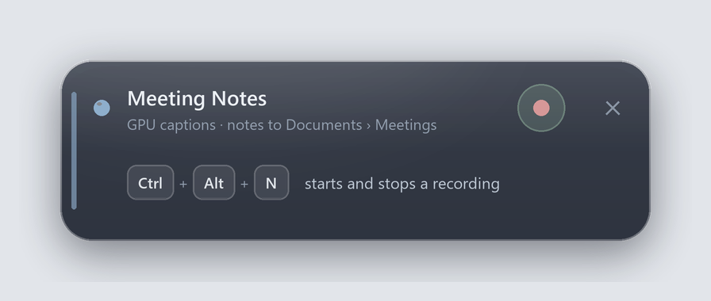
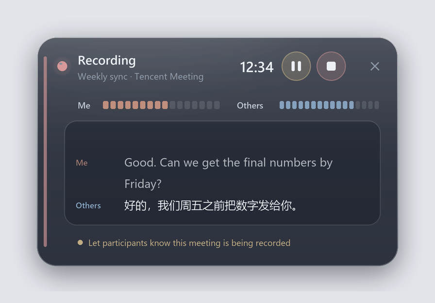
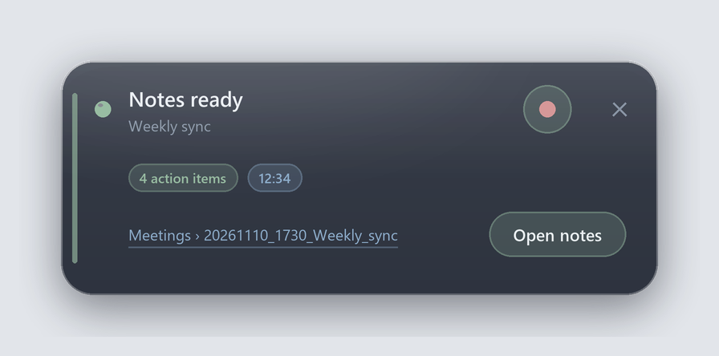

# Meeting Notes

A small Windows panel that records any online meeting from your PC (Google Meet, Zoom, Microsoft Teams, Tencent Meeting, Feishu / Lark, or anything else that plays through your speakers). It shows live captions while you talk, then writes a transcript, a compressed audio file and structured notes when you stop.

Speech recognition runs locally on your GPU with [faster-whisper](https://github.com/SYSTRAN/faster-whisper). Only the finished transcript is sent to a notes engine: the `claude` CLI, or the `codex` CLI as a fallback, using your own account.

| Idle | Recording | Notes ready |
|---|---|---|
|  |  |  |

The screenshots show sample data (`--demo`), not a real meeting.

> **Recording consent.** Before you record, tell everyone in the meeting and get their consent. Many countries and states require the consent of all parties to record a conversation, and many workplaces have their own rules. The panel reminds you while it records ("Let participants know this meeting is being recorded"), but you are responsible for following the law where you and the other participants are. The tool joins no meeting and installs nothing into meeting apps. It records your microphone and what your PC plays, so it also records anything else playing at the same time.

## What it does

- **Two tracks:** your microphone ("Me") and the PC's speaker output through WASAPI loopback ("Others"). Both are saved as 16 kHz WAV chunks while recording. Headsets and Bluetooth earphones are followed when you switch devices mid-meeting.
- **Live captions** with `large-v3-turbo` and Silero VAD. The language is detected for each utterance, and Chinese is converted to Simplified with full-width punctuation.
- **Pause / resume.** Nothing is recorded while paused.
- **After you stop**, the meeting is processed in a separate process:
  1. Final transcript with `large-v3`.
  2. Optional speaker separation of "Others" (Speaker 1, 2, ...) with sherpa-onnx (see *Diarization models*).
  3. Echo removal: microphone lines that only repeat the speakers are dropped.
  4. `transcript.md` and `audio.opus` (encoded to a temporary file, checked for length, then moved into place).
  5. `notes.md`: summary, decisions, action items, open questions and key numbers, in the meeting's main language, plus an English summary for other languages.
  6. The session's WAV chunks are deleted last. That happens only when the audio was verified and saved and the notes were written (unless `--keep-wav`), and only for the chunks that went into the saved audio. Any failure keeps them, and so does any chunk that appeared later.
- **Output:** one folder per meeting, `<output_dir>\<YYYYMMDD_HHMM>_<title>\` with `notes.md`, `transcript.md` and `audio.opus`. If that name is taken, the folder gets the session's start time with seconds, then also a short id.
- **Ownership:** each recording gets a random id. A small `.meeting_notes_session` file in its folder holds that id, and processing writes into or cleans up only a folder whose id matches. Folders from versions before 2026-11-13 (no id) are left read-only.
- **Safe writes:** if the session's `status.json` is held by another program (for example a virus scanner), processing waits a few seconds. If it stays unreadable, it is never treated as empty or rebuilt: work already saved is kept, the stop is logged, and you can resume or retry once the file is readable again. A crash while recording can leave a WAV header that undercounts its samples, so chunks are read to the end of the file. Result files (transcript, notes, audio, session status) are written through a temporary file and then replaced, so an interrupted write leaves the old file or the new one, not half of one. Before a transcript or notes file is replaced, its expected checksum is recorded, so a crash right after the write is recognized and the file is kept.
- **One process per meeting:** a meeting being processed is locked. A second processing command for the same meeting is refused.
- **If the notes fail** (no engine answered): `transcript.md` and `audio.opus` are kept, the WAV chunks are kept, and the session is not marked done. A failed attempt never replaces an existing `notes.md`: on the first failure a short `notes.md` says why, and good notes from an earlier run stay as they are. Retry with `--notes-only` or `--resume` (below). Each time the panel starts, it resumes one unfinished session.
- **If the audio fails to encode:** the WAV chunks are kept, the notes still run, the panel shows "audio not saved · WAVs kept", and the run exits with code 1. Retry the audio with `--audio-only` (below).
- **Rerun protection:** a full run is refused when the meeting is being processed, is already done, already has a saved transcript or results (use `--resume`), has no WAV chunks left, or all folder names belong to other folders. A refusal writes no meeting file, status or log; only the meeting's lock file may be created.
- **When you stop recording,** processing waits until the recorder has closed its files. If that takes longer than a minute, processing is deferred to the next start. If the meeting's `session.json` cannot be read when you name the meeting, it is left untouched and the meeting is processed at the next start.
- **After a crash or power loss** during processing, the next start of the panel picks up the session:
  - If nothing was saved yet and the WAV chunks are there, it runs the session from the start.
  - Otherwise it *resumes*: only the missing steps run (audio, notes, completion), and finished files, good notes and a `--keep-wav` choice are kept.
  - If result files exist that the records cannot account for, the session is left for you to look at.
  - If a result file could not be written at all (for example, blocked by a scanner) and nothing was saved, a plain full run (`meeting_notes_process_v1.py <session>`) may be started again.
  - These steps are tested on copies of sessions with stand-in audio and notes, including simulated crashes between steps. A crash in the middle of a real recording is not tested.

## Requirements

- Windows 10 or 11.
- Python 3.12 with Tk (the python.org installer).
- An NVIDIA GPU with a CUDA 12 driver for real-time captions. The live model uses about 3 GB of VRAM and the final pass about 4.5 to 9 GB. CPU mode works with `"device": "cpu"` and `"compute_type": "int8"`, but it is much slower.
- For notes: the [Claude Code](https://docs.anthropic.com/en/docs/claude-code) CLI (`claude`) or the [Codex](https://github.com/openai/codex) CLI (`codex`) on PATH and signed in. Your usage of those services is subject to their own terms and limits. Without either, you still get the transcript and audio.
- ffmpeg is provided by `imageio-ffmpeg`. Nothing else needs installing.

## Install

```powershell
git clone https://github.com/P3anutSweet/meeting-notes.git
cd meeting-notes
py -3.12 -m venv .venv
.venv\Scripts\python.exe -m pip install -r requirements.txt
```

The Whisper models (`large-v3-turbo`, `large-v3`, several GB) download into `<cache_dir>\models` on first use.

## Run

```powershell
.\meeting_notes_v2.cmd              # start the panel (or show it, if it is already running)
.\meeting_notes_v2.cmd --background # start hidden in the tray (for a Startup shortcut)
```

- **Start / stop:** Ctrl+Alt+N, the round button on the panel, or the tray icon. Ctrl+Alt+Shift+N works as a spare hotkey.
- **Stop** asks for a title. Enter keeps the suggestion, which is taken from the meeting window's title.
- A second launch sends a command to the running copy: `--start`, `--stop "title"`, `--pause`, `--resume`, `--hide`, `--quit`. Add `--no-ledger` to `--stop` to skip the ledger hook for that meeting.
- The launcher uses `%MN_PYTHONW%`, or the path written in `meeting_notes_python.txt` next to it, or `.venv\Scripts\pythonw.exe`.
- Process a session by hand (it must still have its WAV chunks): `.venv\Scripts\python.exe meeting_notes_process_v1.py <cache_dir>\sessions\<id> [--title "..."] [--keep-wav] [--no-ledger]`.
- Retry only the notes from the saved transcript (`segments.json`), without touching `transcript.md` or `audio.opus`: `.venv\Scripts\python.exe meeting_notes_process_v1.py <cache_dir>\sessions\<id> --notes-only`. Add `--force` to rewrite the notes of a session that is already done. The old notes are replaced only if the new ones are generated.
- Retry only the audio after a failed encode: `.venv\Scripts\python.exe meeting_notes_process_v1.py <cache_dir>\sessions\<id> --audio-only`.
- Finish an interrupted session (only the missing steps): `.venv\Scripts\python.exe meeting_notes_process_v1.py <cache_dir>\sessions\<id> --resume`. This is the processor's `--resume`. The panel's own `--resume` is a different command: it continues a paused recording.
- Exit codes: 0 = done (a full run or `--resume` needs both notes and saved audio), 1 = failed (inputs kept), 3 = refused (nothing written).
- Look check without recording: `.venv\Scripts\pythonw.exe meeting_notes_v2.pyw --demo <idle|recording|paused|naming|processing|ready> out.png` renders a state with sample data on a plain background.
- Test without sound: set `MN_TEST_FEED=<file.wav>` to feed a WAV file in place of the computer audio.

To start it at logon, create a shortcut in `shell:startup` to the full path of `.venv\Scripts\pythonw.exe`, with the arguments `-X utf8 "<full path>\meeting_notes_v2.pyw" --background`.

## Settings

All settings are optional. Copy `meeting_notes_settings.example.json` to `meeting_notes_settings.json` next to the scripts and edit it. You can also point `MN_SETTINGS` at a settings file elsewhere. Any key can be overridden with an environment variable named `MN_<KEY>`, for example `MN_OUTPUT_DIR` or `MN_TIME_ZONE`. Lists are written comma-separated, and `true` / `1` turn on a switch. Your `meeting_notes_settings.json` is in `.gitignore`.

| Key | Default | Meaning |
|---|---|---|
| `cache_dir` | `%LOCALAPPDATA%\MeetingNotes` | Sessions (WAV chunks while recording), models, panel state |
| `models_dir` | `<cache_dir>\models` | Whisper and diarization models |
| `output_dir` | `~\Documents\Meetings` | One folder per meeting |
| `log_dir` | `<cache_dir>\logs` | Monthly log file |
| `time_zone` | `local` | `local`, or a fixed UTC offset in hours (e.g. `8`, `-5`) for folder names and times |
| `time_zone_label` | `""` | Label after times; empty = `UTC+hh:mm` |
| `live_model` / `final_model` | `large-v3-turbo` / `large-v3` | faster-whisper model names |
| `device` / `compute_type` | `cuda` / `float16` | e.g. `cpu` / `int8` without a GPU |
| `notes_engines` | `["claude", "codex"]` | Tried in order; `[]` = transcript only |
| `claude_label` / `codex_label` | `Claude (claude CLI)` / `Codex (codex CLI)` | Shown as "Notes written by" |
| `notes_for` / `me_is` | the person who recorded the meeting | Who the notes are for, and who "Me" is (used in the prompt) |
| `limits_json` | `%LOCALAPPDATA%\ai-limits-monitor\latest.json` | Optional [AI Limits Monitor](https://github.com/P3anutSweet/ai-limits-monitor) snapshot: if Claude is at its limit, Codex is tried first |
| `native_minutes` | `false` | Also look up Tencent Meeting / Feishu minutes in the meeting's time window (read-only) |
| `node`, `tmeet_script`, `lark_script` | `""` | Node and the signed-in `tmeet` / `lark-cli` entry scripts for that lookup |
| `ledger_enabled` | `false` | Add one table row per meeting to a Markdown file |
| `ledger_writer` | `markdown` | `markdown` inserts the row after the last table row under `ledger_section` (locked, so concurrent meetings never lose a row) |
| `ledger_path`, `ledger_section` | `""`, `## Reports from other threads` | The Markdown file and the heading of its table |
| `background` | `wallpaper` | Panel glass: frosted desktop wallpaper, or `plain` |

## Privacy

- Audio and transcription stay on your PC. The WAV chunks are deleted only after verified audio and successful notes, unless `--keep-wav` was requested; failures keep the chunks.
- The transcript text, the title and the date are sent to the notes engine you configured (`claude -p` or `codex exec`) under your own account. Set `"notes_engines": []` to keep everything local.
- The optional minutes lookup only reads from the Tencent Meeting / Feishu CLIs you have signed in to. Their credentials stay in those CLIs' own stores.
- Nothing is uploaded anywhere else. The tool collects no telemetry.

## Diarization models (optional, not bundled)

Speaker separation of "Others" needs two ONNX models. Without them, every remote voice is labelled "Others".

| File | Model | Source and license |
|---|---|---|
| `<models_dir>\diar\sherpa-onnx-pyannote-segmentation-3-0\model.onnx` | pyannote **segmentation-3.0** (© 2022 CNRS), ONNX export by sherpa-onnx | [sherpa-onnx speaker-segmentation models](https://github.com/k2-fsa/sherpa-onnx/releases/tag/speaker-segmentation-models) (`sherpa-onnx-pyannote-segmentation-3-0.tar.bz2`), converted from [pyannote/segmentation-3.0](https://huggingface.co/pyannote/segmentation-3.0). **MIT license**. The original Hugging Face repository is gated: you accept its conditions to download it there. |
| `<models_dir>\diar\emb.onnx` | 3D-Speaker **ERes2Net base** speaker embedding (`iic/speech_eres2net_base_sv_zh-cn_3dspeaker_16k`, 16 kHz) | [sherpa-onnx speaker-recognition models](https://github.com/k2-fsa/sherpa-onnx/releases/tag/speaker-recongition-models) (`3dspeaker_speech_eres2net_base_sv_zh-cn_3dspeaker_16k.onnx`, renamed to `emb.onnx`), from the [3D-Speaker](https://github.com/modelscope/3D-Speaker) project (Apache-2.0). Check the license on the model's own [ModelScope card](https://www.modelscope.cn/models/iic/speech_eres2net_base_sv_zh-cn_3dspeaker_16k) before you redistribute it. |

Any other sherpa-onnx speaker-embedding model can be saved as `emb.onnx` instead. Check each model's license yourself. This repository bundles no model files.

## Limits

- Windows only (WASAPI loopback, layered windows, global hotkeys).
- Speaker numbers are automatic and can be wrong, especially with overlapping speech or similar voices.
- Whisper can mishear names and numbers. The notes engine is told to fix obvious errors from context and never invent facts, but check important numbers against `transcript.md`.
- Known Whisper hallucinations on silence ("thanks for watching", subtitle credits) are filtered out. Others may slip through.
- If your microphone also picks up your speakers, echo removal drops most repeated lines. Headphones give the cleanest result.

## Troubleshooting

- **Missing cuBLAS / cuDNN DLLs:** install the `nvidia-cublas-cu12` and `nvidia-cudnn-cu12` wheels into the same venv (they are in `requirements.txt`), and update the NVIDIA driver.
- **Empty "Me" meter:** check Windows microphone privacy settings and the default input device.
- **Empty "Others" meter:** the loopback follows the *default* output device. Make the meeting app play there.
- **No notes:** run `claude` or `codex` once in a terminal and sign in, then retry with `--notes-only`. The transcript and audio are kept when the notes fail.
- Logs: `<log_dir>\meeting_notes_<YYYYMM>.log`.

## Not affiliated

This is an independent tool. It is not affiliated with, endorsed by or sponsored by Google, Zoom, Microsoft, Tencent, ByteDance (Feishu / Lark), Anthropic, OpenAI, CNRS / pyannote, Alibaba (3D-Speaker) or k2-fsa (sherpa-onnx). All product names are trademarks of their owners.

## License

GPL-3.0: see [LICENSE](LICENSE). Third-party packages and models keep their own licenses.
